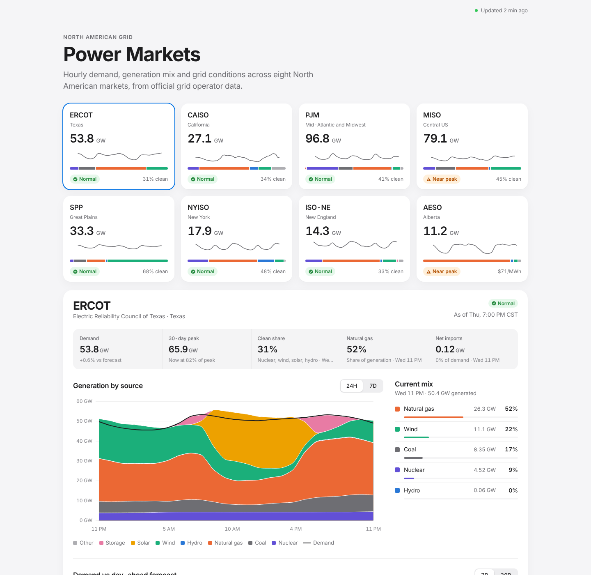

# Power Markets

**Hourly demand, generation mix and grid conditions across eight North American electricity markets.**

[](https://moezusb.github.io/power-market-monitor)


→ **[Open the live monitor](https://moezusb.github.io/power-market-monitor)**



---

## What it shows

Eight markets side by side: **ERCOT, CAISO, PJM, MISO, SPP, NYISO, ISO-NE** and **AESO** (Alberta).

For each market:

- **Demand now** in GW, with a 48-hour sparkline
- **Generation by source**: stacked hourly mix for the last 24 hours or 7 days, with demand overlaid
- **Current mix**: share of gas, nuclear, coal, wind, solar, hydro, storage and other
- **Demand vs day-ahead forecast** over 7 or 30 days
- **Net imports** from the operator's reported interchange
- **Alberta pool price** (CAD/MWh), since Alberta is a single-price energy-only market
- A **conditions** flag based on two transparent rules:
  - *Near peak*: demand is at least 95% of the highest hour in the last 30 days
  - *Above forecast*: demand is running at least 4% over the day-ahead forecast

The conditions flag is a simple signal, not a reserve-margin or price forecast.

## Data sources

| Market | Source | Notes |
|---|---|---|
| ERCOT, CAISO, PJM, MISO, SPP, NYISO, ISO-NE | [EIA Hourly Electric Grid Monitor](https://www.eia.gov/electricity/gridmonitor/) (form EIA-930) via the EIA Open Data API v2 | Recent hours are preliminary and can be revised |
| AESO | [AESO public ETS reports](http://ets.aeso.ca/): Current Supply Demand, Actual/Forecast | Fuel-mix history is built from hourly snapshots |

## How it works

```
GitHub Actions (hourly)                     GitHub Pages
scripts/fetch_power.py  ──►  data/power.json  ──►  index.html
  EIA API (key in repo secret)                 Chart.js, no build step
  AESO public reports (no key)
```

- A scheduled workflow (`.github/workflows/update-data.yml`) runs every hour, pulls the data server-side and commits `data/power.json`.
- The page reads that one JSON file, so it loads instantly, works for every visitor without an API key, and never hits CORS issues.
- If a source fails, the last good data for that market is kept.

## Design

Rebuilt in 2026 with an Apple-style interface: system font stack, grouped cards, segmented controls, automatic light and dark mode. The fuel palette was checked for colour-blind separation between adjacent stacked series, and every chart has a legend plus a value list so colour is never the only cue.

## Running locally

```bash
export EIA_API_KEY=your_key      # free at eia.gov/opendata/register.php
python scripts/fetch_power.py    # writes data/power.json (stdlib only)
python -m http.server            # open http://localhost:8000
```

To deploy your own copy, add `EIA_API_KEY` under **Settings → Secrets and variables → Actions**.

## What I would build next

- Real-time LMPs for ERCOT and CAISO (both publish public price feeds)
- Day-ahead vs real-time price spreads
- Estimated carbon intensity per market

---

*Independent side project. Part of a macro and energy markets series. See also: [Yield Curves](https://moezusb.github.io/yield-curve-monitor).*
